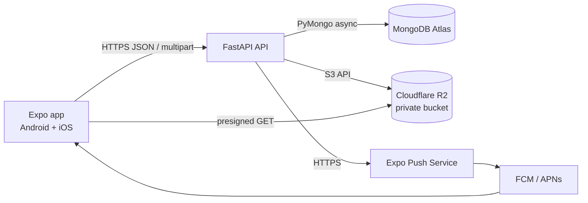
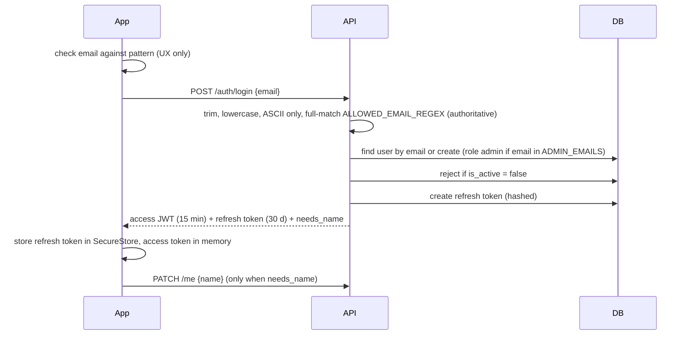

# Architecture — E-DUMP

Owner correction, 21 October 2026: email-code authentication replaces the historical pattern-only flow below. POST /auth/login sends a challenge; POST /auth/verify requires mailbox proof before issuing sessions. Mailjet HTTPS delivery is a backend integration. Legacy sessions and notification registrations are rejected. See EmailAuthentication.md.


## 1. System overview



Principles:

1. **The API is the only writer.** The app never talks to MongoDB. It talks to R2 only through short-lived presigned **download** URLs issued by the API.
2. **Uploads go through the API** (not directly to R2). At 25 MB max and 60 users this is simple and lets the server validate size, type and duplicates before anything is stored.
3. **Authorization is enforced server-side on every route.** UI hiding is cosmetic.
4. **One section, one tenant.** No multi-tenancy abstractions.
5. **Boring layers**: router → service → repository. No framework magic beyond FastAPI dependencies.

## 2. Backend layers

```
router (HTTP, validation, auth dependency)
  └─ service (business rules, permissions, orchestration)
       ├─ repository (MongoDB queries only)
       ├─ storage (R2 client)
       └─ push (Expo push client)
```

Rules: routers never touch the database; repositories never raise HTTP errors; services raise domain errors (`NotFound`, `Forbidden`, `Conflict`, `Invalid`) which one exception handler maps to HTTP.

## 3. Data model (MongoDB)

All ids are `ObjectId` internally, exposed as strings. All timestamps are UTC `datetime`, serialised as ISO-8601 with `Z`.

### `users`
```
_id, email (lowercase, unique), name (display name; null until the user sets it),
role: "student" | "admin", is_active: bool, roll_no (derived from email local part, optional),
last_seen_updates_at, created_at, last_login_at
```
Index: `email` unique.

### `subjects` (seeded)
```
_id, slug (unique), name, short_name, credits (int|null), teacher (str|null),
kind: "theory"|"lab", sort_order, aliases: [str]
```

### `schedule_slots` (seeded)
```
_id, subject_slug, weekday (1=Mon..7=Sun), start "HH:mm", end "HH:mm", venue
```

### `files`
```
_id, key (R2 object key), original_name, mime_type, size_bytes, sha256,
uploader_id, status: "ready"|"deleted", created_at
```
Key format: `files/{yyyy}/{mm}/{uuid4}.{ext}` (never the user's filename). Index: `sha256`.

### `materials`
```
_id, subject_slug, file_id, title, kind: "slides"|"notes"|"assignment"|"past_paper"|"book"|"other",
chapter (int|null), description (str|null), uploader_id, uploader_name_snapshot,
search_text (lowercased title + chapter label + original filename), status: "active"|"removed",
created_at, updated_at
```
Indexes: `(subject_slug, status, created_at desc)`, `(subject_slug, kind, chapter)`, `(file_sha256, subject_slug)` enforced via lookup on `files.sha256` for the duplicate guard (store `file_sha256` on the material too and index `(subject_slug, file_sha256)` unique among active).

### `announcements`
```
_id, type: "quiz"|"task"|"datesheet"|"general", title, body, subject_slug (null),
due_at (null), file_ids: [≤3], pinned: bool, author_id, author_name_snapshot,
created_at, updated_at
```
Indexes: `(pinned desc, created_at desc)`, `(subject_slug, created_at desc)`, `(due_at)` partial where `due_at` exists.

### `reports`
```
_id, material_id, reporter_id, reason: "wrong_subject"|"inappropriate"|"copyright"|"duplicate"|"other",
note (≤200), status: "open"|"resolved"|"dismissed", resolved_by, created_at
```
Index: `(status, created_at)`. Unique `(material_id, reporter_id)`.

### `devices`
```
_id, user_id, expo_push_token (unique), platform: "android"|"ios", notifications_enabled: bool, created_at, last_seen_at
```

### `refresh_tokens`
```
_id, user_id, token_hash (sha256), family_id, expires_at (TTL index), revoked_at (null), replaced_by (null), created_at, user_agent
```

## 4. API surface (`/api/v1`)

Auth is `Authorization: Bearer <access_jwt>` unless marked public. Errors share one shape (§6).

### Auth and profile
| Method | Path | Who | Purpose |
|---|---|---|---|
| POST | `/auth/login` | public | Body `{email}` validates the student pattern and sends a code; returns `{challenge_id, expires_in, retry_after}`, never tokens |
| POST | `/auth/verify` | public, mailbox proof | Body `{email, challenge_id, code}` consumes a valid one-use code before issuing `{access_token, refresh_token, user, needs_name}` |
| POST | `/auth/refresh` | public | Body `{refresh_token}` → rotates → new pair |
| POST | `/auth/logout` | user | Revokes the presented refresh token family |
| GET | `/me` | user | Current user |
| PATCH | `/me` | user | Body `{name}` (2–40 chars) |
| DELETE | `/me` | user | Delete account (AUTH-5) |
| POST | `/me/seen-updates` | user | Sets `last_seen_updates_at = now` |
| PUT | `/me/devices` | user | Upsert `{expo_push_token, platform, notifications_enabled}` |
| DELETE | `/me/devices/{token}` | user | Remove on sign-out |

### Subjects, schedule
| GET | `/subjects` | user | Subjects with `material_count` |
| GET | `/subjects/{slug}` | user | One subject |
| GET | `/schedule` | user | All slots |

### Material
| Method | Path | Who | Purpose |
|---|---|---|---|
| GET | `/subjects/{slug}/materials?kind=&chapter=&q=&cursor=&limit=20` | user | List |
| POST | `/subjects/{slug}/materials` | user | `multipart/form-data`: `file`, `title`, `kind`, `chapter?`, `description?` |
| GET | `/materials/recent?limit=10` | user | Recently added (P1) |
| GET | `/materials/{id}` | user | Detail |
| PATCH | `/materials/{id}` | uploader or admin | Edit metadata (P1) |
| DELETE | `/materials/{id}` | uploader or admin | Soft remove + delete object |
| GET | `/materials/{id}/download` | user | → `{url, expires_in, filename, mime_type, size_bytes}` presigned GET |
| POST | `/materials/{id}/report` | user | Body `{reason, note?}` |

### Announcements
| GET | `/announcements?type=&subject=&cursor=&limit=20` | user | List (pinned first, then newest) |
| GET | `/announcements/upcoming?limit=3` | user | Next due items |
| GET | `/announcements/unread-count` | user | Count since `last_seen_updates_at` |
| GET | `/announcements/{id}` | user | Detail with attachment descriptors |
| POST | `/announcements` | admin | Create (+ push) |
| PATCH | `/announcements/{id}?notify=false` | admin | Edit; `notify=true` re-sends push |
| DELETE | `/announcements/{id}` | admin | Delete |
| POST | `/announcements/attachments` | admin | `multipart` single file → `{file_id, ...}` (status pending until attached) |
| GET | `/announcements/{id}/attachments/{file_id}/download` | user | Presigned GET |

### Admin
| GET | `/admin/users?q=` | admin | Users with role/active/last login, search by name or email |
| PATCH | `/admin/users/{id}` | admin | `{role?, is_active?}` (cannot demote or disable yourself) |
| GET | `/admin/reports?status=open` | admin | Reports queue |
| PATCH | `/admin/reports/{id}` | admin | `{action: "remove_material"|"dismiss"}` |

### Ops
`GET /healthz` (public, no DB write), `GET /readyz` (checks Mongo ping).

## 5. Key flows

### 5.1 Sign-in

Mailbox proof is mandatory before session issuance. email_auth_service consumes the code, then auth_service.login_with_email applies active-account checks, admin bootstrap and account onboarding. Private routes reject legacy sessions without auth_version=2.

Refresh tokens rotate on every use; presenting an already-rotated token revokes the whole family. The access JWT carries only `sub`, `iat`, `exp`; the API loads the user from the database on each request so role changes and disables apply immediately.

### 5.2 Upload
1. App sends multipart to `POST /subjects/{slug}/materials` with progress tracking.
2. API streams the body to a temp file, rejecting beyond `MAX_UPLOAD_MB` while streaming.
3. API checks: extension allowlist, magic-byte type matches extension and declared MIME, computes SHA-256.
4. Duplicate check on `(subject_slug, sha256)` → `409 duplicate` with `existing_material_id`.
5. API uploads to R2 with key `files/yyyy/mm/uuid.ext`, inserts `files` then `materials`. If the Mongo insert fails, delete the R2 object.
6. Returns the material.

### 5.3 Open a file
App calls `GET /materials/{id}/download` → receives a presigned GET URL valid `DOWNLOAD_URL_TTL_SEC` → downloads to `FileSystem.cacheDirectory/files/{file_id}.{ext}` (reuse if present) → opens with the system viewer (iOS `expo-sharing`, Android `expo-intent-launcher` VIEW intent with content URI). Images open in the in-app image viewer.

### 5.4 Announcement and push
1. Admin submits form; attachments were uploaded first through `/announcements/attachments`.
2. API inserts the announcement and marks attached files `ready`.
3. A FastAPI background task loads devices with `notifications_enabled`, excludes the author's devices, sends to the Expo push API in batches of 100.
4. Payload `data: {announcement_id}`; tap handler navigates to `/updates/[id]`.
5. Responses with `DeviceNotRegistered` delete that token.
Failure of push never fails the create request; it is logged.

### 5.5 Housekeeping
An in-process asyncio task (started in the FastAPI lifespan) runs hourly: delete `files` with status pending older than 24 h (object + record). Single instance only; this is acceptable at this scale.

## 6. Conventions

**Error shape**
```json
{ "error": { "code": "duplicate", "message": "This file is already uploaded in COAL.", "details": { "existing_material_id": "..." } } }
```
Codes: `unauthorized`, `forbidden`, `not_found`, `validation_error`, `duplicate`, `file_too_large`, `unsupported_type`, `rate_limited`, `invalid_email`, `account_disabled`, `invalid_token`.

**Pagination**: cursor = base64 of `{created_at, _id}`; response `{items: [], next_cursor: string|null}`.

**Rate limits** (per user, in memory via slowapi): 10 login attempts/min/IP and 5/min/email, 20 uploads/hour, 60 reads/min, 5 reports/hour.

**Search**: normalise query (lowercase, trim, split on whitespace, escape regex), AND-match each token against `search_text`. Numeric-only token also matches `chapter`. Adequate for hundreds of documents per subject.

**Clients**: mobile keeps TanStack Query cache persisted to AsyncStorage (stale time 60 s for lists, 5 min for subjects); optimistic UI is limited to delete and pin.

**Logging**: JSON lines to stdout, request id per request, never log tokens, id_tokens, emails in bulk, or file contents.

## 7. Deployment

- Dockerfile for `backend/` (python slim, `uv sync --frozen`, run `uvicorn app.main:app --host 0.0.0.0 --port 8080`, 2 workers max).
- Secrets via host secret manager. Health check `/healthz`.
- Atlas daily snapshots are not on M0; run a weekly `mongodump` script (`scripts/backup.sh`) to R2 bucket prefix `backups/` with 30-day lifecycle.
- Mobile releases: `eas build --profile preview --platform android` for APK; `eas build --profile production --platform ios` then TestFlight; JS-only hot fixes with `eas update`.

## 8. Decisions log

| # | Decision | Reason | Revisit when |
|---|---|---|---|
| 1 | Proxy uploads through API | Server-side validation and dedupe, simple | Files > 50 MB or > 500 users |
| 2 | Presigned GET for downloads | Keeps bandwidth off the API | Never needed |
| 3 | Own JWT issued after mailbox verification | Short sessions, instant revoke, no password | If SSO becomes required |
| 4 | Student pattern plus one-use email code | Proves access to the student mailbox | If class roster enforcement becomes required |
| 5 | No Redis/queue | 60 users, in-process tasks suffice | Multiple API instances |
| 6 | System viewer for PDFs | Zero native PDF dependencies | Students request in-app viewing |
